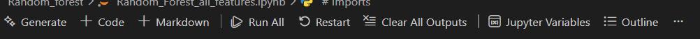

# Ransomware Adversarial Generation Engine (RAGE)

## Overview

This Repository contains the implementation of the RAGE framework. It is a framework that generates adversarial ransomware samples in the feature space that are able to deceive various machine learning models. This README contains the instructions to clone, set up and generate adversarial ransomware samples.

## Branches

### 1. *Static-Samples* 
   This is the default branch of the repository. It contains the experiments that are referenced in the results section of the academic work that this Repository is related to. 

### 2. *Main* 
This is an extra branch of the repository and it contains the initial implementation of the RAGE framework

## RAGE Framework Context
The RAGE framework is constructed to implement a custom adversarial algorithm found in the *attack_functionality* folder to generate ransomware adversarial samples. 
Adversarial samples are generated by attacking a surrogate model. 

In this version of the repository the adversarial samples are generated by attacking two different surrogate models 

1. Decision Tree Surrogate Model 
2. Random Forest Surrogate Model  

The RAGE framework consists of Experiment Notebook Files that contain the implementation of the RAGE framework under different conditions in each surrogate model folder 

1. decision_tree 
2. Random_forest 

Each Surrogate Model folder contains an experiment notebook carried out under different conditions to simulate ransomware detectors trained under different constraints namely 

1. C1 - All features of the dataset in its original form (data/ds_with_sample_name.csv) 

2. C2 - Top 100 features of the original dataset using the  ```surrogate_model.feature_importances_() ``` technique  

3. C3 - Top 50 features of the original dataset using the  ```surrogate_model.feature_importances_() ``` technique  

4. C4 - Top 20 features of the original dataset using the  ```surrogate_model.feature_importances_() ``` technique  

5. C5 - Custom feature set of the original dataset 

6. C6 - All features of the dataset which has been balanced using the ```RandomUnderSampler()``` technique 

7. C7 - Top 100 features of the balanced dataset using the ```surrogate_model.permutation_importance()``` technique 

8. C8 - Top 50 features of the balanced dataset using the ```surrogate_model.permutation_importance()``` technique 

9. C9 - Top 20 features of the balanced dataset using the ```surrogate_model.permutation_importance()``` technique 

10. C10 - Custom featureset of the balanced dataset 

## Repository Structure
The repository is comprised of the adversarial algorithm, dataset and experiments conducted during the course of this research. 

```text
.
├── README.md                                   # The readme for this repo 
├── requirements.txt                            # The required libraries
├── .gitingore                                  # items for git to ignore
├── Adversarial_candidate_indices/              # Indices of the adversarial candidates             
│   └── dt_adversarial_indices 
|   └── dt_balanced_adversarial_indices
|   └── rf_adversarial_indices 
|   └── rf_balanced_adversarial_indices
└── Adversarial_Samples/                        # Saved adversarial samples  
|   ├── DT_surrogate_adversarial_samples
|   |  └── ... 
|   |── RF_surrogate_adversarial_samples  
|      └── ...
└── attack_functionality                        # Logic implementation of the adversarial algorithm 
|   └── functionality_preserving attack.py 
|   └── General_attack.py
├── data                                        # Dataset used to train surrogate and target models
|   └── dataset.csv
|   └── balanced_dataset.csv
│
├── decision_tree                               # Adversarial Attack experiments using the Decision Tree Surrogate model 
|    └── DT_surrogate_experiment: C1.ipynb
│    └── DT_surrogate_experiment: C2.ipynb 
│    └── DT_surrogate_experiment: C3.ipynb
│    └── DT_surrogate_experiment: C4.ipynb
│    └── DT_surrogate_experiment: C5.ipynb
│    └── DT_surrogate_experiment: C6.ipynb
│    └── DT_surrogate_experiment: C7.ipynb
│    └── DT_surrogate_experiment: C8.ipynb
│    └── DT_surrogate_experiment: C9.ipynb
│    └── DT_surrogate_experiment: C10.ipynb
│ 
├── Random_forest                               # Adversarial Attack experiments using the Random Forest Surrogate model
|    └── RF_surrogate_experiment: C1.ipynb
│    └── RF_surrogate_experiment: C2.ipynb
│    └── RF_surrogate_experiment: C3.ipynb
│    └── RF_surrogate_experiment: C4.ipynb
│    └── RF_surrogate_experiment: C5.ipynb
│    └── RF_surrogate_experiment: C6.ipynb
│    └── RF_surrogate_experiment: C7.ipynb
│    └── RF_surrogate_experiment: C8.ipynb
│    └── RF_surrogate_experiment: C9.ipynb
│    └── RF_surrogate_experiment: C10.ipynb
│
├── Extras                                      # Extra files for adhoc functionality -- Not required to run the experiments
│
├── utils                                       # logging functionality 
  
```

## Requirements
In order to execute the experiments contained in this repo you would need: 
 - Python (3.10.9) or higher 
 - Anaconda Distribution 
 - Jupyter Notebook (Alternatively Jupyter extension on Visual Studio Code) 

The libraries (also found in requirements.txt) that will be used in the various experiments are:
 - pandas              |       # for dataset manipulation
 - numpy               |       # to work with numpy arrays
 - scikit-learn        |       # for traditional model selection, Scaling tools, and preprocessing  
 - matplotlib          |       # to plot graphs   
 - seaborn             |       # for visualisations
 - xgboost             |       # standalone XG-Boost install because it is not included in scikit-learn library 

## Setup
The repo has been tested and cloned using Python version 3.10.9 and 3.13 as well as on a windows 10 machine and windows 11 machine. 
Select one option for the set up

### Option A: Anaconda
1. Install the anaconda distribution [Anaconda](https://www.anaconda.com/download)
2. Follow the default installation steps. 
3. The default kernel that comes with a fresh version of the Anaconda distribution will most likely contain the libraries and tools needed. 
4. The only thing that might not be installed is XG-Boost and random_undersampler this can be rectified by runnning the following commands in an cell in the experiment file of your choosing: 

     ``` python
      !pip install xgboost 
      ```
     ``` python 
      !pip install imbalanced-learn
      ```
5. Install the Jupyter extension in Visual studio code 
6. Open the experiment file of your choosing. 
7. The notebook should be populated and ready to run. 

### Option B: pip + ipykernel
1. Create and activate a virtual environment in the repo folder:

```
   python -m venv venv
```
   - Windows: `venv\Scripts\activate`

2. Install the dependencies:

```bash
   pip install -r requirements.txt
```
3. Register the environment as a Jupyter kernel:

```bash
   python -m ipykernel install --user --display-name "Python (RAGE)"
```

4. Open an experiment file and choose **Kernel → Change kernel → Python (RAGE)**.

5. The notebook should be populated and be ready to run

## Running the Notebooks
If the set up has been successful this control panel should appear at the top of the notebook: 



The option to run cells should be available. 

## Reproducing Results
The results of the academic work associated with this repo can be achieved by simply choosing an experiment notebook in either surrogate model and clicking the "Run All" button

## Reproducibility Notes

### Ensure you are on the default branch (static-samples) as this is the branch where the results are derived from
